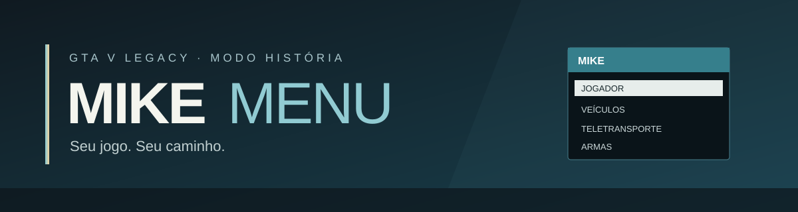

  
  
<strong>Um menu em português para aproveitar o GTA V do seu jeito.</strong>

  
Windows · GTA V Legacy · Modo história

  
<a href="https://github.com/mayc7n/menugtav/raw/refs/heads/main/MikeMenu.zip"><strong>⬇ BAIXAR O MIKE MENU</strong></a>

## Como instalar

**Já usa mods de script no GTA?** Então é só:

1. [Baixar o Mike Menu](https://github.com/mayc7n/menugtav/raw/refs/heads/main/MikeMenu.zip) e extrair o ZIP.
2. Com o jogo fechado, copiar a pasta **scripts** extraída e colar na pasta do GTA V, onde fica o `GTA5.exe`. Se já existir uma pasta `scripts`, copie para dentro dela o arquivo `MikeMenu.3.dll` e a pasta `MikeMenuAssets`.
3. Abrir o modo história e apertar **Del**. Pronto!

**É a primeira vez que usa mods?** Antes dos passos acima, instale o [Script Hook V](https://www.dev-c.com/gtav/scripthookv/) e o [ScriptHookVDotNet](https://github.com/scripthookvdotnet/scripthookvdotnet/wiki/Getting-Started). Eles são necessários para o menu funcionar e têm suas próprias instruções de instalação. Faça uma cópia do seu save antes de começar.

O menu é para **GTA V Legacy no Windows, modo história**. A edição Enhanced não foi testada. Remova os mods antes de entrar no GTA Online.

## Como usar

Aperte **Del** para abrir ou fechar. Navegue com as **setas**, escolha com **Enter** e volte com **Backspace**. Para dinheiro, use **F10** para definir o saldo e **F11** para adicionar uma quantia.

Você encontra opções para cuidar do personagem, ajustar o nível de procurado, receber armas, escolher e tunar veículos, mudar o clima e se teletransportar. A disponibilidade de veículos, armas e peças varia conforme o jogo.

Em **Armas**, escolha uma arma individual ou reponha a munição. Em **Roupas**, escolha uma peça e percorra modelos e texturas: a mudança aparece diretamente no personagem. Para desfazer, use **Restaurar peça anterior** antes de sair daquela peça; voltar ou fechar o menu mantém a escolha atual. Em **Veículo atual**, há também opções para tentar desvirar o veículo e ligar o motor. Os nomes dos veículos usam a tradução disponível no jogo.

Em **Polícia**, ative ou desative **Nunca procurado**; escolher um nível de procurado desliga essa opção. Em **Pedestres**, é possível atrair até dez civis próximos por alguns segundos, chamar até três guarda-costas ou solicitar um motorista. Para o motorista, marque um destino, entre como passageiro em um carro parado e deixe o banco do motorista livre. O menu tenta usar imagens do jogo para oito armas e cinco veículos; para outros veículos e roupas usa ilustrações genéricas identificadas. A roupa escolhida aparece no próprio personagem.

Em **Jogador → Habilidades**, alterne superpulo, corrida e natação rápidas; há também animações e acesso ao paraquedas. Em **Armas**, há munição infinita para a arma selecionada, opção sem recarga, acessórios compatíveis e tiros explosivos ou incendiários. Em **Veículos**, há controles de portas, vidros e motor, e três espaços para salvar e recriar carros. Em **Roupas → Trajes salvos**, salve e aplique trajes do mesmo protagonista. Cada gravação substitui o conteúdo anterior do espaço. Veículos salvos preservam modelo, cores padrão, rodas, peças disponíveis, turbo e placa; cores personalizadas, neon e alguns detalhes podem não ser recuperados. Em **Mundo**, alterne relógio parado e blecaute. No menu principal, **Desligar efeitos ativos** desativa os efeitos temporários do menu.

Com o menu fechado, use **Ctrl+F5** para recuperar vida e colete, **Ctrl+F6** para reparar e limpar o veículo atual e **Ctrl+F7** para alternar Nunca procurado. Outros mods podem usar os mesmos atalhos. As novas funções e imagens precisam de teste dentro do GTA V; sua disponibilidade depende do personagem, veículo e versão do jogo.

Em **Veículos → Escolher veículo**, pesquise pelo nome exibido e pressione **F5** em um modelo para adicioná-lo ou removê-lo dos favoritos. Em **Teletransporte → Locais salvos**, há três espaços para gravar posições. Em **Armas → Kits de armas**, há três espaços por protagonista para armas e munição; acessórios não são salvos. O menu também inclui velocímetro, impulso, freio, rádio portátil, densidade de trânsito e pedestres e a opção de permanecer na moto.

Os atalhos de vida, reparo e polícia podem ser alterados em `scripts/MikeMenu/atalhos.ini`, criado ao iniciar o menu. Edite com o jogo fechado e reinicie; use combinações de Ctrl, Shift ou Alt com F1–F9 ou F12. F10, F11 e Del permanecem reservados. Se o arquivo for inválido, o menu usa os atalhos padrão sem apagá-lo.

O menu também aceita imagens específicas em `scripts/MikeMenuAssets`: `veiculo_HASH.png` e `roupa_PROTAGONISTA_COMPONENTE_MODELO_TEXTURA.png`, com hashes hexadecimais de oito dígitos. A roupa é identificada separadamente para Michael, Franklin e Trevor. Essas imagens específicas não são incluídas automaticamente; na ausência delas, são usadas as imagens internas disponíveis ou ilustrações genéricas.

## Precisa de ajuda?

- **O menu não abriu?** Confira se os dois pré-requisitos estão instalados, se o arquivo `MikeMenu.3.dll` ficou na pasta `scripts` do jogo e se você está no modo história. Depois, reinicie o jogo.
- **Já tinha o menu antigo?** Remova `MenuHistoria.3.dll` ou `DinheiroHistoria.3.cs` da pasta `scripts` antes de instalar a versão nova, para evitar dois menus iguais.
- **Quer desinstalar?** Feche o jogo e remova `scripts/MikeMenu.3.dll` e a pasta `scripts/MikeMenuAssets`. Os favoritos ficam em `scripts/MikeMenu`; preserve essa pasta se quiser mantê-los.

O [guia de instalação](desenvolvimento/LEIA-ME.txt) também está dentro do ZIP. Para detalhes sobre erros, consulte `ScriptHookVDotNet.log` na pasta do jogo.

## Sobre o projeto

O código, os testes e as ferramentas ficam na pasta [desenvolvimento](desenvolvimento/); **você não precisa mexer nela para instalar**. A DLL foi compilada com a API v3 do ScriptHookVDotNet 3.7.0-nightly.201. A versão atual ainda precisa de teste em jogo.

Projeto independente, sem vínculo com a Rockstar Games. GTA e Grand Theft Auto são marcas de seus respectivos titulares. As dependências são projetos de terceiros e têm suas próprias licenças. Este repositório ainda não declara uma licença para reutilização do código.
