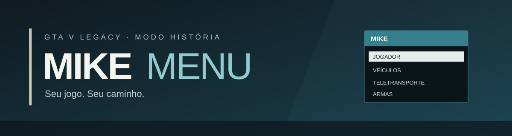

  
  
<strong>Um menu em português para aproveitar o GTA V do seu jeito.</strong>

  
Windows · GTA V Legacy · Modo história

  
<a href="https://github.com/mayc7n/menugtav/raw/refs/heads/main/MikeMenu.zip"><strong>⬇ BAIXAR O MIKE MENU</strong></a>

## Como instalar

**Já usa mods de script no GTA?** Então é só:

1. [Baixar o Mike Menu](https://github.com/mayc7n/menugtav/raw/refs/heads/main/MikeMenu.zip) e extrair o ZIP.
2. Com o jogo fechado, copiar a pasta **scripts** extraída e colar na pasta do GTA V, onde fica o `GTA5.exe`. Se já existir uma pasta `scripts`, copie apenas o arquivo `MikeMenu.3.dll` para dentro dela.
3. Abrir o modo história e apertar **F9**. Pronto!

**É a primeira vez que usa mods?** Antes dos passos acima, instale o [Script Hook V](https://www.dev-c.com/gtav/scripthookv/) e o [ScriptHookVDotNet](https://github.com/scripthookvdotnet/scripthookvdotnet/wiki/Getting-Started). Eles são necessários para o menu funcionar e têm suas próprias instruções de instalação. Faça uma cópia do seu save antes de começar.

O menu é para **GTA V Legacy no Windows, modo história**. A edição Enhanced não foi testada. Remova os mods antes de entrar no GTA Online.

## Como usar

Aperte **F9** para abrir ou fechar. Navegue com as **setas**, escolha com **Enter** e volte com **Backspace**. Para dinheiro, use **F10** para definir o saldo e **F11** para adicionar uma quantia.

Você encontra opções para cuidar do personagem, ajustar o nível de procurado, receber armas, escolher e tunar veículos, mudar o clima e se teletransportar. A disponibilidade de veículos, armas e peças varia conforme o jogo.

## Precisa de ajuda?

- **O menu não abriu?** Confira se os dois pré-requisitos estão instalados, se o arquivo `MikeMenu.3.dll` ficou na pasta `scripts` do jogo e se você está no modo história. Depois, reinicie o jogo.
- **Já tinha o menu antigo?** Remova `MenuHistoria.3.dll` ou `DinheiroHistoria.3.cs` da pasta `scripts` antes de instalar a versão nova, para evitar dois menus iguais.
- **Quer desinstalar?** Feche o jogo e remova apenas `scripts/MikeMenu.3.dll` da pasta do GTA.

O [guia de instalação](desenvolvimento/LEIA-ME.txt) também está dentro do ZIP. Para detalhes sobre erros, consulte `ScriptHookVDotNet.log` na pasta do jogo.

## Sobre o projeto

O código, os testes e as ferramentas ficam na pasta [desenvolvimento](desenvolvimento/); **você não precisa mexer nela para instalar**. A DLL foi compilada com a API v3 do ScriptHookVDotNet 3.7.0-nightly.201. A compilação renomeada e a correção mais recente do teletransporte ainda precisam de teste em jogo.

Projeto independente, sem vínculo com a Rockstar Games. GTA e Grand Theft Auto são marcas de seus respectivos titulares. As dependências são projetos de terceiros e têm suas próprias licenças. Este repositório ainda não declara uma licença para reutilização do código.
